```{r setup, include = FALSE}
knitr::opts_chunk$set(
  collapse = TRUE,
  comment = "#>"
)
```
# Graded Response Model 

Norming a test with polytomous items is highly similar to the procedure with 
binary items. Therefore, we will focus here on the differences to the previously
discussed example with the 2PLnorm model.

The new response data consists of 25 items each with either 3 or 4 different scoring options. 
```{r loadGRMdata, echo=TRUE, include=TRUE, warning=FALSE, message = FALSE}
data("data_GRM")
```
## Preparing data for IRT-based norming
The data preparation for the GRM model is highly similar to that of the binary models, 
but there is two details that needs careful consideration. While for the binary models 
item responses response coding started with zero, for the GRM the smallest category is one. 
Therefore if a individuals did the item fully incorrect, they should get the coding 1. If this
is not the case, `data_prep()` will transform the data and show a warning. 
Second the maximum number of points per items needs to be indicated with 'K_item'. 
In this example all maximum response categories been achieved, such that we can get 
them from the data. 
```{r data_prepGRM, echo=TRUE, include=TRUE}
K_item <- matrixStats::colMaxs(as.matrix(data_GRM[,1:20]))
```

## Fit a specified norming models and extract importen model information 
This is fully similar to the procedure with the 2PLnorm model, as all important 
model information is directly provided with the data from `data_prep()`.
Since model comparison is also similar to the already discussed model comparison, 
we are using here the ideal model and presume the model has been evaluated for 
convergence. 
```{r fit_GRMnorm, include=TRUE, eval = FALSE}
infoGRM <- estimate_norming_model(raw_data = data_GRM, 
                               age_variable = "age", 
                               item_variables = 1:25,
                               irt_model  = "GRMnorm", 
                               age_model = "poly", 
                               poly_mean = 3, 
                               poly_sd = 2, 
                               K_item = K_item,
                               seed = 1234,
                               iter_warmup = 2000,
                               iter_sampling =2000, 
                               extract_stan_object = FALSE)


```

```{r load_GRMnorm,  echo=FALSE, include= TRUE}
data(info_polyGRM)
```

## Fit evaluation  
While most fit evaluation are completly similar to the binary case the item fit 
evaluation differs as the scatter plot could be misleading as it ignores the order 
of the item responses. 
For the GRMnorm model the function `item_person_fit()` shows for item fit 
a stacked histogram of the frequency of the response categories with observed and 
model implied frequencies next to each other. 
```{r showfit4_ITEM, echo=TRUE, include=TRUE, fig.show="hold",  fig.width=6,fig.height=4, fig.align = "center"}
item_person_fit(fit_info =infoGRM, parameter = "item")
``` 
The observed and model-implied frequencies align sufficently for all items, 
indicating that the estimated item parameters describe the data accurately.


## Norms for a new sample of individuals
When norming new individuals with a GRMnorm model it is important to ensure the 
response coding is similar in the for the new individual as it was for when 
fitting the model. This implies that the coding of all items should start with 1. 
If this is ensured, the rest is IRT model independent. 
The new individual of interest has the response pattern `y`and the age `age`. 
```{r newobsGRM, echo=TRUE, include=TRUE, eval = FALSE}
y <-  c(1,1,1,4,1,2,1,4,2, 1, 3, 4, 1, 3, 1, 3, 1, 1, 1, 3, 2, 4, 3, 1, 1) 
age <- 0.25

GRM_newperson <- estimate_theta_new(new_y = y, new_age= age,
                           data = data_polyGRM, post_draw = norm_infoGRM,
                           mh_args = list(n_iter=100, burnin=50, thin=2, proposal_sd=0.6))
GRM_newperson$summary
``` 

```{r newobsGRM,  echo=FALSE, include= TRUE}
data(GRMsummary)
GRMsummary
``` 
Our best estimate of the individuals latent trait is XX which implied the 
individual is above average. Further, one can say that with 95\% certanty the true 
norm score values lies between XX and XX. 


# Hierachical Models 
Some tests have a hierarchical structure, such that the full test measures a 
certain latent trait, while subtests of the tests measure unique latent traits. 
Then it can be assumed that items hold information regarding a unique latent trait 
and a general latent trait. When applying IRT-based continous norming this hierarchical structure 
can be modeled with a hierachical IRT model. The norming is performed similar to 
unidimensional IRT-based norming but the hierachical structure has to be acknoleged in 
model checking. This vingette focuses on the special considerations for hierarchical 
test. For a general example about IRT-based norming using IRTnorm we refere to the 
vingette for unidimensional models. 

The exemplary data we are using is generated under the HOnorm-F model with three domains. 
The following code loads the required package and the example data.


```{r loadlibrary, eval = TRUE, echo=TRUE, include=TRUE, warning=FALSE, message = FALSE}
library(IRTnorm)
library(ggplot2)
data("HOdata")
```

For this example we assume we know which model fits the data best. How to select 
the best model is described in the 2PLnorm vingette. 
```{r fit_bestmodel, echo=TRUE, include=TRUE, eval = FALSE}
infoHO <- estimate_norming_model(irt_model = "HO1PLnorm-C",
                               raw_data = HOdata, 
                               age_variable = "age", 
                               item_variables = 1:90,
                               itemD = rep(1:3, each = 30),
                               age_model = "poly", 
                               poly_mean = 3, 
                               poly_sd = 2, 
                               seed = 1234,
                               iter_warmup = 500,
                               iter_sampling =500, 
                               extract_stan_object = TRUE)
```

```{r NC1, echo=TRUE, include=TRUE ,eval = FALSE}
NC_info <- raw_score_ppc(fit_info = infoHO)
visual_raw_score_ppc(NC_info)
``` 

```{r NC2, echo=FALSE, fig.width=6, out.width="100%",fig.align="center"}
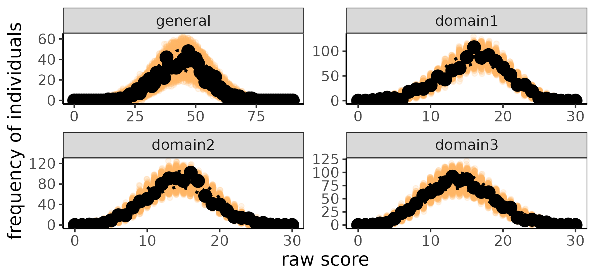
``` 

```{r ageMC, echo=TRUE, include=TRUE ,eval = FALSE}
NC_info_age <- raw_score_ppc(fit_info = infoHO, age_range = seq(-2,2,1))
visual_raw_score_ppc(NC_info_age, dim_plot = "general")
visual_raw_score_ppc(NC_info_age, dim_plot = "domain1")
``` 

```{r showNC2, echo=FALSE, fig.width=6, out.width="100%",fig.align="center"}
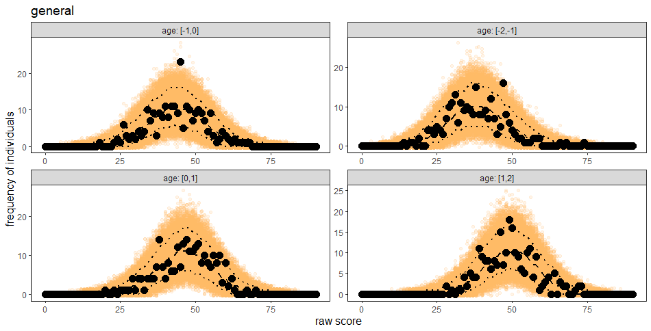
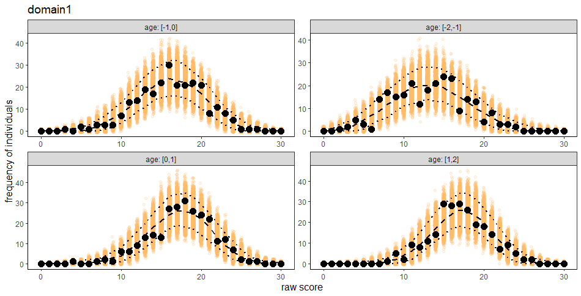
``` 

```{r itemfit, echo=TRUE, include=TRUE ,eval = FALSE}
item_person_fit(fit_info =infoHO, parameter = "item")
``` 

```{r itemfitshow, echo=FALSE, fig.width=6, out.width="100%",fig.align="center"}
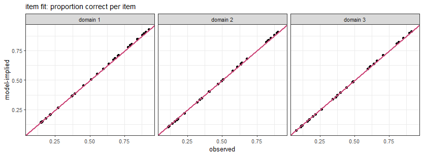
``` 


```{r personfit, echo=TRUE, include=TRUE ,eval = FALSE}
item_person_fit(fit_info =infoHO, parameter = "person")
``` 

```{r personfitshow, echo=FALSE, fig.width=6, out.width="100%",fig.align="center"}
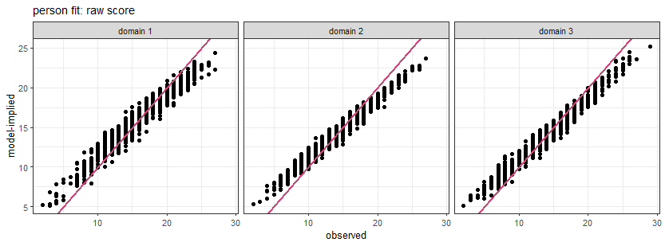
``` 

```{r qcurv, echo=TRUE, include=TRUE ,eval = FALSE}
quantile_curves(fit_info = infoHO, probs = c(0.05, 0.25, 0.5, 0.75, 0.95))
``` 

```{r qcurvshow, echo=FALSE, fig.width=6, out.width="100%",fig.align="center"}
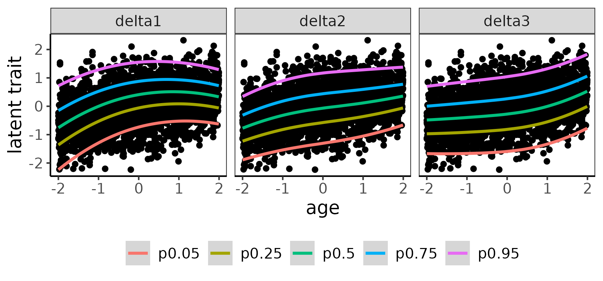

``` 

```{r normscore, echo=TRUE, include=TRUE ,eval = FALSE}
normscore_dist(fit_info= infoHO, age_range = seq(5,21,4), binwidth = 0.8, dim_plot = "general")
``` 
```{r normscoreplot, echo=FALSE, fig.width=6, out.width="100%",fig.align="center"}
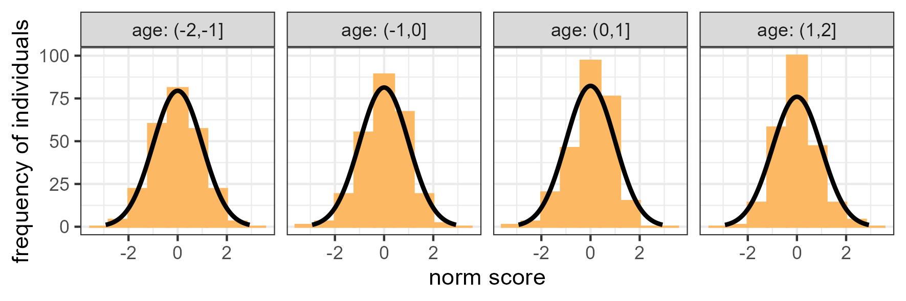
``` 

```{r normscore1, echo=TRUE, include=TRUE ,eval = FALSE}
normscore_dist(fit_info= infoHO, age_range = seq(5,21,4), binwidth = 0.8, dim_plot = "domain1")
``` 
```{r normscoreplot1, echo=FALSE, fig.width=6, out.width="100%",fig.align="center"}
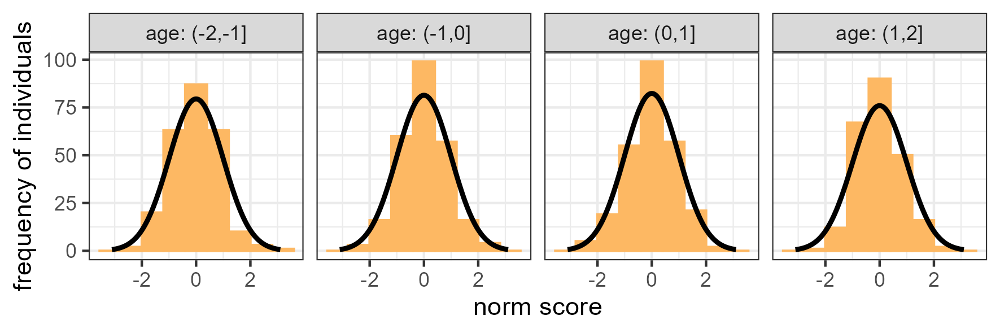
``` 


```{r itemresidualall, echo=TRUE, include=TRUE ,eval = FALSE}
res_info <- item_residual_cor(fit_info = infoHO)
``` 

```{r itemresidualall_results, echo=FALSE,eval = TRUE}
test_env <- new.env()
data("test", package = "IRTnorm", envir = test_env)
test_env$test$summary_info
test_env$test$compare_domains
``` 

```{r residualplotall, echo=FALSE, fig.width=6, out.width="100%",fig.align="center"}
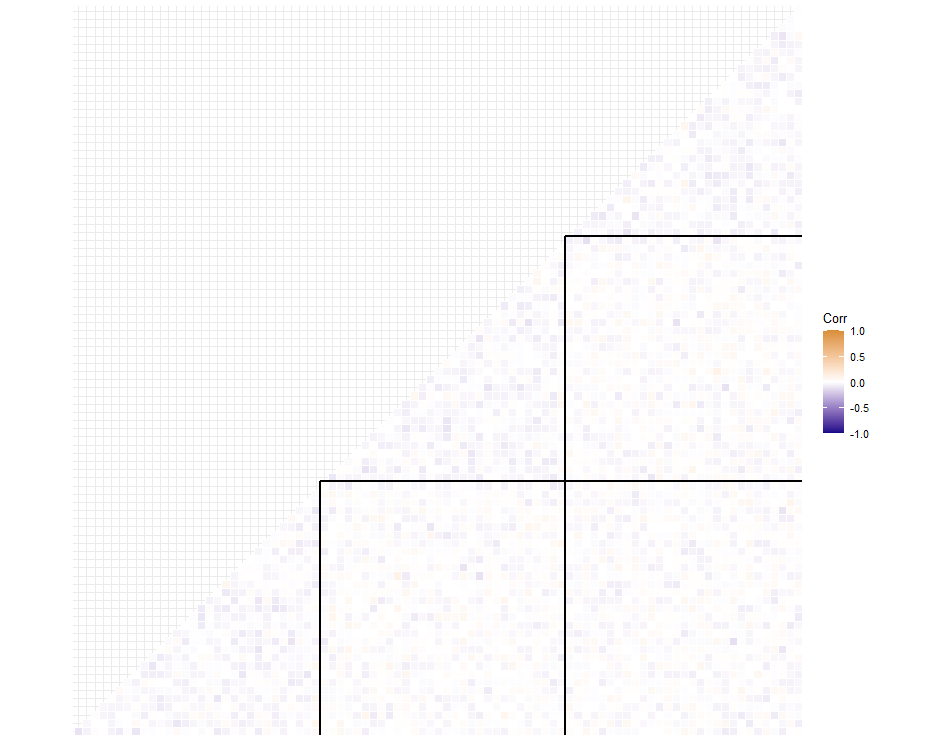
``` 

```{r itemresidual1, echo=TRUE, include=TRUE ,eval = FALSE}
item_residual_cor(fit_info = infoHO, domain = 1)
``` 

```{r itemresidual1_results, echo=TRUE, include=FALSE ,eval = TRUE}
test_env <- new.env()
data("HOex_res_info1", package = "IRTnorm", envir = test_env)
test_env$HOex_res_info1
``` 

```{r residualplot1, echo=FALSE, fig.width=6, out.width="100%",fig.align="center"}
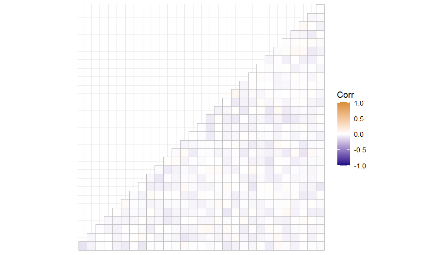
``` 


```{r domaincor, echo=TRUE, include=TRUE ,eval = FALSE}
cor_info <- cor_structure(fit_info = infoHO)
``` 
```{r domaincor_results, echo=TRUE, include=FALSE ,eval = TRUE}
test_env <- new.env()
data("HOex_cor_info", package = "IRTnorm", envir = test_env)
test_env$cor_info

``` 


```{r effect_age, echo=TRUE, include=TRUE ,eval = FALSE}
effect_age(fit_info = infoHO)
``` 
```{r effectageplot, echo=FALSE, fig.width=6, out.width="100%",fig.align="center"}
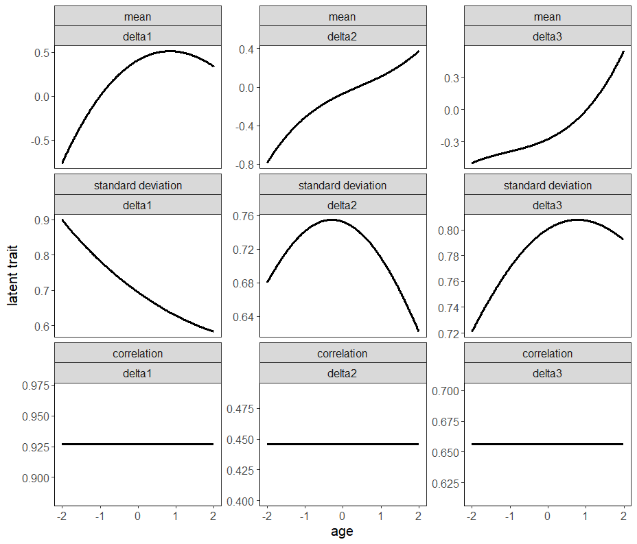
``` 

To norm new individuals is similar 
```{r newperson, echo=TRUE, include=TRUE ,eval = FALSE}
y <- HOdata[65, 1:90]
age <- HOdata$age[65]

info_newperson <- norm_new_individual(new_y = y, new_age= age + 0.3,
                                      fit_info = infoHO)
``` 

```{r info_newperson, echo=TRUE, include=FALSE ,eval = FALSE}
info_newperson$summary
``` 
```{r load_newperson,  echo=FALSE, include= TRUE, eval = TRUE}
data("HOex_info_newperson", package = "IRTnorm", envir = test_env)
test_env$info_newperson$summary
``` 
