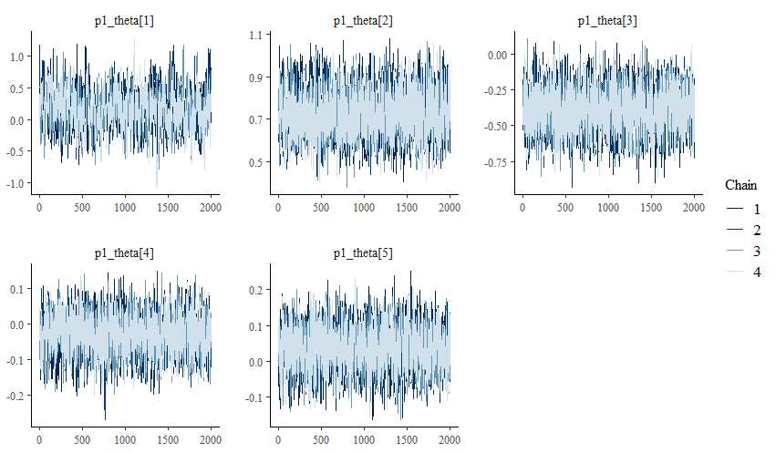
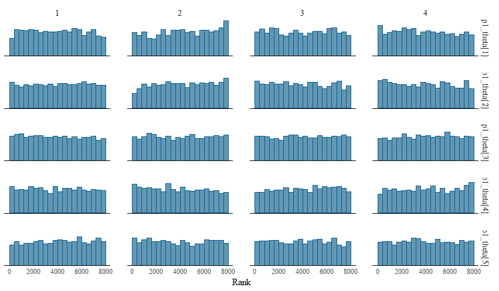
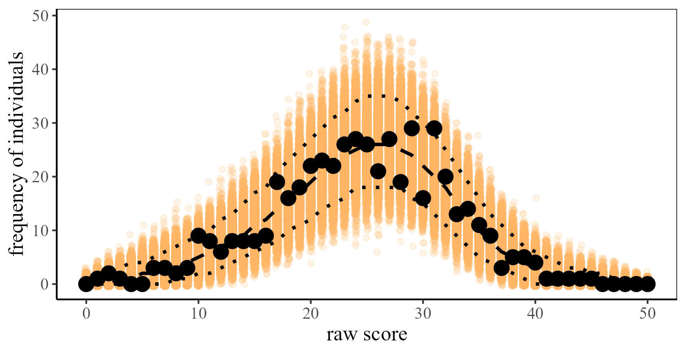
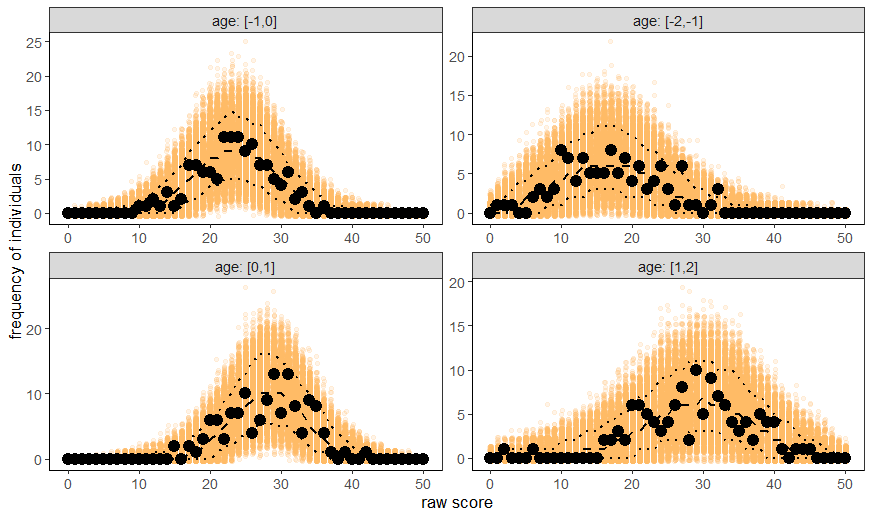
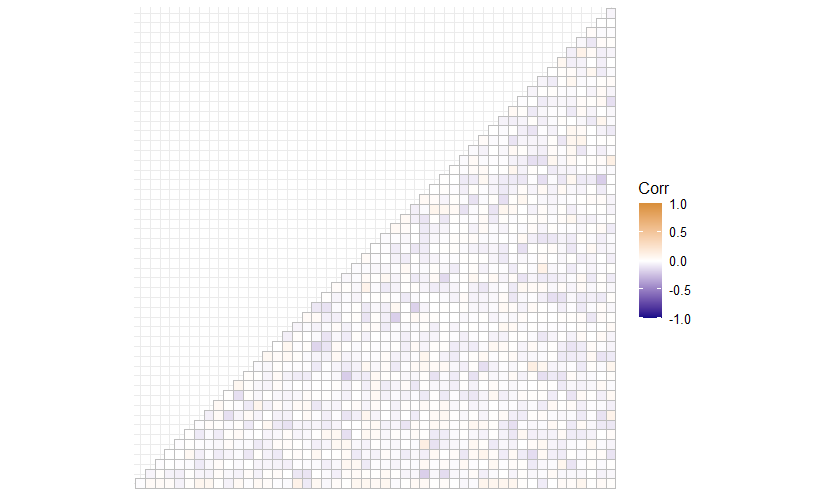

```{r setup, include = FALSE}
knitr::opts_chunk$set(
  collapse = TRUE,
  comment = "#>"
)
```

# Introduction

Norm-referenced psychological tests evaluate an individual's performance
relative to a reference population, typically using standardized scores such
as T-, IQ- or z-scores (@AERA2014). Many developmental and intelligence tests
rely on reference populations that change continuously with age.

In such settings, item response theory (IRT)-based continuous norming models
are useful for deriving age-specific norm information. These models
explicitly allow the latent trait distribution to depend on age. As a result,
each individual's latent trait estimate can be directly compared to the
age-specific reference population using a z-standardized norm score
(@heister2024item). As in most parametric IRT models, the latent trait
distribution is assumed to be normal in the reference population. Because the
latent trait distribution of psychological tests typically changes smoothly
with age, the mean and standard deviation can be modeled as smooth functions
of age, using polynomial regression or penalized splines.

Simulation studies have shown that IRT-based continuous norming models can
accurately recover age-specific norms, and an empirical evaluation with the
IDS-2 (@grob2018idsNL) has shown that these models can fit empirical data
well (@heister2024item). Compared to raw score-based continuous norming
methods, the default approach in many applications, IRT-based models use all
available item-level information, can model multiple latent traits and their
relationships, and integrate straightforwardly with adaptive testing.

`IRTnorm` implements a framework for deriving age-specific norm scores using
Bayesian IRT-based continuous norming models. It includes tools for model
comparison, model estimation, visual inspection of model fit, and norming of
new individuals.

This vignette introduces the main modeling concepts of `IRTnorm` and
demonstrates their use on a unidimensional test with binary items. For items
with more than two ordered response categories (graded response model) and
for tests with several domains (hierarchical models), see
`vignette("special-cases")` after reading this vignette. The models are
fitted with Stan, so the package `cmdstanr` and a working CmdStan
installation are required.

# Workflow overview

The main workflow in `IRTnorm` consists of four steps:

1. **Select a model** (`compare_IRTnorm_models()`, `compare_age_models()`,
   `visual_age_models()`).
2. **Fit the selected model** and extract all important model information
   (`estimate_norming_model()`).
3. **Evaluate model fit**:

   | Function | What it checks |
   |---|---|
   | `raw_score_ppc()`, `visual_raw_score_ppc()` | observed vs. model-implied raw score distributions |
   | `item_person_fit()` | observed vs. model-implied item and person properties |
   | `item_residual_cor()` | local independence of the items |
   | `quantile_curves()` | consistency of the estimates with the model-implied quantiles |
   | `normscore_dist()` | normality of the norm scores within age groups |
   | `effect_age()` | plausibility of the estimated age trajectories |
   | `cor_structure()` | correlations between domains (hierarchical models only, see `vignette("special-cases")`) |

4. **Norm new individuals** (`norm_new_individual()`).

---

# Norming a unidimensional test

We illustrate the workflow with a small simulated data set (`response_data`),
to keep the example concise. In practical applications, larger data sets are
usually required. The age variable in this data set is on a standardized
scale, which is why ages such as -1 and age groups such as `seq(-2, 2, 1)`
appear below. Item responses are binary and coded 0 and 1.

```{r loadlibrary, echo=TRUE, include=TRUE, warning=FALSE, message=FALSE}
library(IRTnorm)
library(ggplot2)
data("response_data")
```

## 1. Select a model

Selecting an appropriate IRT-based norming model requires considering a set
of plausible models. The models can differ in the IRT model, in the
specification of the age effects, or in both. We first choose the IRT model
and then the age model.

### Choosing the IRT model

Candidate IRT models should be pre-selected based on the characteristics of
the test. For example, if the test contains binary items and guessing might
influence the responses, a 3PL-norm model can be evaluated alongside the
2PL-norm model. If guessing is unlikely, 1PL- and 2PL-norm models are
sufficient.

The function `compare_IRTnorm_models()` fits the models and compares their
expected log predictive density (ELPD), estimated with approximate
leave-one-out cross-validation (LOO-CV) using the `loo` package (@loo2026).

The models are specified in the `model_specifications` argument, a list with
one element per model. Each element is itself a list that contains at least
`irt_model` (the IRT model) and `age_model` (`"poly"` for polynomial
regression or `"splines"` for penalized splines). Additional options depend
on the age model; see `?estimate_norming_model` for all of them.

For a fair comparison, use the same age model in all models, with polynomial
degrees high enough to capture the underlying trajectory. Here we use a
fourth-degree polynomial for the mean and a third-degree polynomial for the
standard deviation. By default, 500 warm-up and 500 sampling iterations are
used per chain, which keeps the computation time low. More iterations can
improve precision for complex comparisons, but we keep the default here.

The data are supplied via `raw_data`, a `data.frame` or `matrix` with the
individuals' ages and item responses. The age variable (`age_variable`) and
the item variables (`item_variables`) can be given by name or by column
position.

```{r fit_IRTmod, echo=TRUE, include=TRUE, eval=FALSE}
model_list <- list(
  list(irt_model = "1PLnorm", age_model = "poly",
       poly_mean = 4, poly_sd = 3),
  list(irt_model = "2PLnorm", age_model = "poly",
       poly_mean = 4, poly_sd = 3)
)

IRTmods <- compare_IRTnorm_models(model_specifications = model_list,
                                  raw_data = response_data,
                                  age_variable = "age",
                                  item_variables = 1:50)
```

```{r load_modelcomparee, echo=FALSE, include=TRUE, eval=TRUE}
data("IRTmods")
```

The result contains the model comparison (`best_model`) and sampling
diagnostics (`diagnostics`). Before interpreting the ELPD differences, we
check that the LOO approximation is reliable by counting Pareto k values
above 0.7.

```{r checkparetok1, echo=TRUE, include=TRUE, eval=TRUE}
sum(IRTmods$diagnostics$pareto_k > 0.7)
```

No Pareto k value exceeds 0.7, so the LOO approximation is stable enough to
rely on the ELPD differences.

```{r load_modelcomparee2, echo=TRUE, include=TRUE, eval=TRUE}
IRTmods$best_model
```

`ELPD_diff` is the difference in ELPD to the best model, and `SE` is the
standard error of this difference. We recommend selecting the more complex
IRT model if its ratio `ELPD_diff / SE` is below -1.96. 
This is a guideline only; the best decision rule depends on the application, 
and other rules may be defensible.
In this example, the selected criterion is met, and
we therefore select the 2PL-norm model for the remainder of the analysis.

### Choosing the age model

Next, we determine the most appropriate specification of the age effect.
The function `compare_age_models()` (available for unidimensional models
only) compares age models by their ELPD, either over a user-specified grid
of polynomial degrees (`method = "grid"`) or by forward selection
(`method = "forward"`). Forward selection starts with the simplest model and
increases the polynomial degree of the mean or the standard deviation step by
step as long as the ELPD improves, up to a maximum number of model fits
(`maxeval`). It is usually more efficient than a grid search, but because it
is greedy, it can miss better combinations. Setting `include_splines = TRUE`
additionally compares the polynomial models with penalized splines.

```{r fit_poly, echo=TRUE, include=TRUE, eval=FALSE}
agemodel_2PL <- compare_age_models(method = "forward",
                                   irt_model = "2PLnorm",
                                   raw_data = response_data,
                                   age_variable = "age",
                                   item_variables = 1:50,
                                   include_splines = TRUE)
```

```{r load_modelcompare3, echo=FALSE, include=TRUE}
data("agemodel_2PL")
```

Again, we first check whether the LOO approximation is stable.

```{r load_paretok_age, echo=TRUE, include=TRUE, eval = FALSE}
colSums(agemodel_2PL$paretok > 0.7)
```
```{r load_paretok_ageinfo, echo=FALSE, eval = TRUE}
c(0,0,0,0 ,0, 1 ,1 ,0, 0, 0, 0 ,0)
```
Two of the evaluated models have Pareto k values above 0.7. To see whether
these influential observations affect the model selection, we repeat the
forward selection with these responses set to missing. First, we identify
the influential responses. Then, we create a new data set,
`response_data_excl`, in which they are missing.

```{r load_modelcompare4, echo=TRUE, include=TRUE, eval=FALSE}
temp <- data_prep(raw_data = response_data,
                  age_variable = "age",
                  item_variables = 1:50,
                  age_model = "splines")

excl <- unique(unlist(lapply(seq_len(ncol(agemodel_2PL$paretok)), function(i) {
  which(agemodel_2PL$paretok[, i] > 0.7)
})))

# temp$jj: person index, temp$ii: item index of each response.
# The "+ 1" skips the age column, which is the first column of response_data.
response_data_excl <- response_data
for (ex in excl) {
  response_data_excl[temp$jj[ex], temp$ii[ex] + 1] <- NA
}

agemodel_2PL_excl <- compare_age_models(method = "forward",
                                        irt_model = "2PLnorm",
                                        raw_data = response_data_excl,
                                        age_variable = "age",
                                        item_variables = 1:50,
                                        include_splines = TRUE)
```

```{r load_modelcompare5, echo=FALSE, include=TRUE}
data("agemodel_2PL_excl")
```

```{r load_paretok_age2, echo=TRUE, include=TRUE, eval = FALSE}
colSums(agemodel_2PL_excl$paretok > 0.7)
```
```{r load_paretok_age2info, echo=FALSE, eval = TRUE}
c(0,0,0,0 ,0, 0 ,0 ,0, 0, 0, 0 ,0)
```
After excluding the two influential responses, no highly influential
observations remain. This will not always be the case. Our aim is to check
how much the influential observations affect the model selection, so we
compare the ELPD of both data sets.

```{r compare_paretok_age2, echo=TRUE, include=TRUE, fig.width=6, fig.height=4, fig.align="center"}
combi <- cbind(rbind(agemodel_2PL$best_model, agemodel_2PL_excl$best_model),
               data = c(rep("original", nrow(agemodel_2PL$best_model)),
                        rep("excluded", nrow(agemodel_2PL_excl$best_model))))
combi$poly_mean[is.na(combi$poly_mean)] <- "splines"
combi$poly_sd[is.na(combi$poly_sd)] <- "splines"

ggplot(combi) +
  geom_point(aes(poly_mean, ELPD, shape = data, color = poly_sd), size = 2) +
  labs(x = "polynomial degree for mean", color = "degree for sd",
       shape = "data") +
  theme_bw()
```

The magnitude of the ELPD differs slightly between the two data sets, but the
general pattern is the same. A second-degree polynomial for the standard
deviation performs best in both. Only for the mean is there a small
discrepancy: the original data favor the third-degree polynomial, and the
data without the influential responses favor the fourth-degree polynomial.

Because these differences in performance are small, we argue that the
selection should be based not only on the ELPD but also on the resulting
trajectories. To inspect them, use `perspective = "trajectory"` in
`visual_age_models()`. The number of highlighted top-ranked models is set
with `highlight_ranks`.

```{r load_modelcompare6, echo=TRUE, include=TRUE, eval=TRUE, fig.width=6, fig.height=4, fig.align="center"}
visual_age_models(agemodel_2PL, perspective = "trajectory", highlight_ranks = 3)
```

We have a strong theoretical expectation that the mean of the latent trait
does not decrease strongly for older individuals. We therefore select the
trajectory that keeps the mean as stable as possible for these individuals,
which is the model with the second-best ELPD rank. The ELPD plot shows that
this is the model with a fourth-degree polynomial for the mean and a
second-degree polynomial for the standard deviation. In this plot, the
y-axis is the ELPD difference divided by its standard error, so values close
to 0 indicate models that are hard to distinguish from the best model.

```{r load_modelcompare7, echo=TRUE, include=TRUE, eval=TRUE, fig.width=6, fig.height=4, fig.align="center"}
visual_age_models(agemodel_2PL, perspective = "ELPD", highlight_ranks = 3)
```

## 2. Fit the selected model

Once the norming model has been selected, it is refitted with a sufficient
number of iterations to obtain the final estimates. The function
`estimate_norming_model()` fits the model and extracts all information needed
for evaluating the model and norming new individuals.

```{r data_prep2, echo=TRUE, include=TRUE, eval=FALSE}
info <- estimate_norming_model(raw_data = response_data,
                               age_variable = "age",
                               item_variables = 1:50,
                               irt_model = "2PLnorm",
                               age_model = "poly",
                               poly_mean = 4,
                               poly_sd = 2,
                               seed = 1234,
                               iter_warmup = 2000,
                               iter_sampling = 2000,
                               extract_stan_object = TRUE)
```

```{r load_info, echo=FALSE, include=TRUE}
data("info_small")
```

### Check convergence

Reliable inference requires that the MCMC sampler has converged. We start
with the numerical diagnostics.

First, the model should have no divergent transitions:

```{r divergent, echo=TRUE, include=TRUE, eval=FALSE}
sum(info$model_stan_obj$sampler_diagnostics()[, , "divergent__"])
```

```{r divergent2, echo=FALSE, include=TRUE, eval=TRUE}
0
```

Two further key diagnostics are the potential scale reduction factor (R-hat)
and the effective sample size (ESS). R-hat should be close to 1 (commonly,
below 1.01), indicating agreement between the chains. Larger ESS values
indicate more precise estimates.

```{r showfit02, echo=TRUE, include=TRUE, eval=TRUE}
info$conv_info
```

In this example, R-hat is below 1.01 for all parameter groups, and the ESS
exceeds 400 for all parameters, indicating good convergence. The bulk and
tail ESS (`ess_bulk` and `ess_tail`) are also similar. A substantial
difference between them can indicate sampling problems that need further
investigation.

The numerical diagnostics should be complemented by visual checks for key
parameters, such as the regression coefficient of the latent trait mean
(`p1_theta`). Trace plots show whether the chains mix well:

```{r showfit03, echo=TRUE, include=TRUE, eval=FALSE}
library(bayesplot)
conv_plot <- bayesplot::mcmc_trace(info$model_stan_obj$draws(c("p1_theta")))
conv_plot
```

```{r showconvplot, echo=FALSE, fig.width=6, out.width="100%", fig.align="center"}

```

In this example, the chains overlap substantially and move freely through the
same region of the parameter space, with no visible trends, drifts, or
abrupt jumps. Rank plots additionally reveal convergence problems in the
posterior tails:

```{r showhist, echo=TRUE, include=TRUE, eval=FALSE}
hist_plot <- bayesplot::mcmc_rank_hist(info$model_stan_obj$draws(c("p1_theta")))
hist_plot
```

```{r showhistplot, echo=FALSE, fig.width=6, out.width="100%", fig.align="center"}

```
In this example, the rank plots look approximately uniform, indicating good
convergence.

If the trace plots show systematic patterns, the rank plots are clearly not
uniform, R-hat is high, or the ESS is low, the model needs more sampling. 
A good first step is to increase the number of warm-up iterations (`iter_warmup`) 
before considering other adjustments.


## 3. Evaluate model fit

Once convergence has been established, we evaluate how well the model fits
the observed data. Each of the following checks looks at a different aspect
of the model.

### Raw score distribution

A useful first diagnostic is to compare the observed raw score distribution
with the distribution implied by the fitted model (a posterior predictive
check). It is computed with `raw_score_ppc()` and plotted with
`visual_raw_score_ppc()`. We begin with the complete sample.

```{r NC1, echo=TRUE, include=TRUE, eval=FALSE}
raw_ppc <- raw_score_ppc(fit_info = info)
visual_raw_score_ppc(raw_ppc)
```

```{r NC2, echo=FALSE, fig.width=6, out.width="100%", fig.align="center"}

```

The black points are the observed frequencies of each raw score, the orange
points are the frequencies in the replicated data (one point per posterior
draw), and the dotted lines mark the 90% credible interval. Most observed raw
scores lie within the interval, and all observed values fall within the range
of the replicated data. The fitted model therefore reproduces the observed
raw score distribution well.

To assess the fit across the full age range, repeat the evaluation for age
groups with the `age_range` argument, which gives the boundaries of the age
groups on the scale of the age variable.

```{r ageMC, echo=TRUE, include=TRUE, eval=FALSE}
raw_ppc_age <- raw_score_ppc(fit_info = info,
                             age_range = seq(-2, 2, 1))
visual_raw_score_ppc(raw_ppc_age)
```

```{r showNC2, echo=FALSE, fig.width=6, out.width="100%", fig.align="center"}

```

The observed raw score distributions appears consistent with those implied by the
model in all age groups.


### Local independence
IRT models assume that items are conditionally independent given the latent
trait. This can be checked with the correlations between the item residuals
(Yen's Q3), computed with `item_residual_cor()`. The function prints a
summary of the correlations between distinct items and plots them as a heat
map.

```{r showfit4_ITEM2, echo=TRUE,eval= FALSE}
item_residual_cor(fit_info = info)
```
```{r showfit4_ITEMnew, echo=FALSE, eval = TRUE, fig.show="hold", fig.width=6, fig.height=4, fig.align="center"}
data("info_residualcor")
info_residualcor

```


The residual correlations are low and do not exceed 0.2, a value commonly
used as a rule of thumb for flagging local dependence. We therefore conclude
that the local independence assumption is plausible.

### Item fit
To examine the fit in more detail, `item_person_fit()` compares observed and
model-implied properties of the items and persons. We start with the item
fit, which compares the observed and model-implied proportion of correct
responses per item.

```{r showfit4_ITEM, echo=TRUE, include=TRUE, fig.show="hold", fig.width=6, fig.height=4, fig.align="center"}
item_person_fit(fit_info = info, parameter = "item")
```

The observed and model-implied proportions are in close agreement, indicating
that the estimated item parameters describe the observed data adequately.

### Person fit

Next, we evaluate the person-level fit, which compares the observed and
model-implied raw score of each person.

```{r showfit4_2, echo=TRUE, include=TRUE, fig.show="hold", fig.width=6, fig.height=4, fig.align="center"}
item_person_fit(fit_info = info, parameter = "person")
```

The observed and model-implied raw scores are in close agreement. A slight
systematic pattern is visible: for high-performing individuals, the model
predicts a somewhat lower raw score than observed, and for low-performing
individuals, a somewhat higher one. This regression towards the mean is
common in Bayesian IRT models because the estimates of the latent trait are
slightly shrunk towards the prior mean. The more informative the test, the
smaller this effect. It does not indicate poor model fit, but it should be
kept in mind when interpreting the results.

### Internal consistency

The following checks examine whether the different parts of the model are
consistent with each other. A model without inconsistencies is not
guaranteed to fit well overall, but inconsistencies point to problems.

First, `quantile_curves()` compares the estimated latent trait values of the
individuals with the quantile curves implied by the model. About 5% of the
points should lie below the 5% curve, about 25% below the 25% curve, and so
on.

```{r showfit5_consist, echo=TRUE, include=TRUE, fig.width=6, fig.height=4, fig.align="center"}
quantile_curves(fit_info = info,
                probs = c(0.05, 0.25, 0.5, 0.75, 0.95))
```

The model-implied quantile curves follow the estimated latent trait values
closely, indicating that the fitted model is internally consistent.

Second, the model assumes that the normed latent trait follows a standard
normal distribution within each age group. The function `normscore_dist()`
plots a histogram of the estimated norm scores for each age group, together
with the density of the standard normal distribution.

```{r showfit6_2, echo=TRUE, include=TRUE, fig.width=6, fig.height=4, fig.align="center"}
normscore_dist(fit_info = info, age_range = seq(-2, 2, 1), binwidth = 0.5)
```

The distributions are approximately normal in all age groups, which further
supports the consistency of the fitted model.

Finally, `effect_age()` shows how the mean and the standard deviation of the
latent trait vary with age. These trajectories should be evaluated against
substantive or theoretical expectations.

```{r showfit6, echo=TRUE, include=TRUE, fig.width=6, fig.height=3, fig.align="center"}
effect_age(fit_info = info)
```

The estimated age effects closely resemble those used to generate the data,
which suggests that the model captures the relationship between age and the
latent trait well.

## 4. Norm new individuals

Suppose a new individual has the item responses `y` and the age `age`. The
responses must be coded in the same way as the data used to fit the model
(here 0 and 1). Missing responses (`NA`) are allowed.

```{r newobs, echo=TRUE, include=TRUE, eval=FALSE}
y <- c(1,1,0,0,1,0,1,1,0,0,1,0,0,1,1,0,0,1,1,0,1,1,1,0,1,0,1,1,1,1,1,1,0,0,0,
       1,0,1,1,0,0,0,0,1,1,1,0,1,0,0)
age <- -1
```

To norm the individual, the fitted model is applied with the posterior draws
of the item parameters and of the latent trait distribution. Only the
individual's latent trait is estimated, and all other parameters stay fixed
at their posterior draws. The norm score is the estimated latent trait
relative to the latent trait distribution of the reference population at the
individual's age. The new data are therefore only used to estimate the
individual's own latent trait. The fitted model is not updated.

The estimation uses random numbers, so set a seed to make the result
reproducible.

```{r getinfo_norming, echo=TRUE, include=TRUE, eval=FALSE}
set.seed(1234)
info_newperson <- norm_new_individual(new_y = y, new_age = age,
                                      fit_info = info)

# summary of the individual's norm score
info_newperson$summary
```

```{r printnorming, echo=FALSE, include=TRUE}
data("int_info_newperson")
int_info_newperson
```

The best estimate of the individual's norm score is 0.939, which is
approximately 0.9 standard deviations above the average of individuals of the
same age. The 95% credible interval of the norm score ranges from 0.001 to
1.893. The individual is therefore likely to perform above average, but there
is limited evidence that the performance is exceptionally high.

# Other models

This vignette used the 2PL-norm model for a unidimensional test with binary
items. For tests with ordered response categories (graded response model) or
with several domains (hierarchical models), the workflow is the same, with a
few additional inputs and fit checks. These are described in
`vignette("special-cases")`.

# Founding 
Development of `IRTnorm` was supported by Dutch Research Council NWO, [grant 406.27.GO.022](https://doi.org/10.61686/YHUOB23106).

# References