```{r setup, include = FALSE}
knitr::opts_chunk$set(
  collapse = TRUE,
  comment = "#>"
)
```

The steps for deriving continuous norms with IRT-based norming are largely
the same across different types of IRT models. The main vignette `vignette("how-to-use-irtnorm")`
provides a detailed explanation of all steps involved in using the 2PL-norm model. The current vignette covers the
special considerations that arise when the data do not meet the assumptions
of that example, that is, when

- the items have more than two ordered response categories (graded response
  model, GRM), or
- the test measures several domains in addition to a general trait
  (hierarchical models).

Both cases require a few additional inputs, which are described below. All
steps not covered here do not depend on the IRT model and are carried out as
described in the main vignette. Therefore, we recommend reading the vignette `vignette("how-to-use-irtnorm")`
first.

```{r grm_loadlibrary, eval=TRUE, echo=TRUE, include=TRUE, warning=FALSE, message=FALSE}
library(IRTnorm)
```

# Graded response model

To illustrate norming with the GRM, we use simulated data with 20 items, each
with 2 to 5 response categories.

```{r grm_loaddata, include=TRUE, eval=FALSE}
data("data_GRM")
```

## Preparing the data

The data preparation differs from the binary case in two ways.

**Response coding.** For binary items, responses are coded 0 and 1. For the
GRM, the lowest category is coded 1. A person who answered an item
completely incorrectly therefore gets the code 1. If the data are coded
differently, `data_prep()` recodes them and shows a warning. 
To avoid coding differences between the norming sample and new individuals, 
we recommend recoding the data yourself so that both are coded identically.

**Number of categories.** The number of response categories of each item must
be supplied with `K_item`. Binary items have two categories, so the minimum
value is 2. With coding from 1, the number of categories equals the maximum
score of the item. In this example, every item has been answered in its top
category at least once, so we can obtain `K_item` from the data:

```{r grm_prepare, echo=TRUE, eval=FALSE, include=TRUE}
K_item <- matrixStats::colMaxs(as.matrix(data_GRM[, 1:20]))
```

If the highest category of an item is not observed in your data, this
shortcut underestimates `K_item`. In that case, specify the numbers of
categories from the test manual.


## Model selection

Model selection under the GRM is limited to the selection of the age-model with `compare_age_models()`, 
since there is currently no alternative IRT model for polytomous responses implemented. 
Selecting the best age-model proceeds as described in the main vignette. 
Here, we assume that the best model has been selected and that
convergence has been checked as described in the main vignette.

## Fitting the model
```{r grm_fit, include=TRUE, eval=FALSE}
infoGRM <- estimate_norming_model(raw_data = data_GRM,
                                  age_variable = "age",
                                  item_variables = 1:20,
                                  irt_model = "GRMnorm",
                                  age_model = "poly",
                                  poly_mean = 3,
                                  poly_sd = 2,
                                  K_item = K_item,
                                  seed = 1234,
                                  iter_warmup = 500,
                                  iter_sampling = 500,
                                  extract_stan_object = FALSE)
```

Here, `extract_stan_object = FALSE` saves memory. The numerical convergence
diagnostics remain available in `infoGRM$conv_info`, but trace and rank plots
need the Stan object. Use `extract_stan_object = TRUE` when you want to
inspect them.

## Evaluating the model fit

Most fit checks are the same as in the binary case. The item fit differs: a
scatter plot of observed and model-implied proportions of correct responses
would be misleading, because it ignores the order of the response categories.
For the GRM, `item_person_fit()` therefore shows, for each item, the observed
and model-implied proportions of responses in each category as stacked bars
next to each other.

```{r grm_itemfit, eval=FALSE, include=TRUE}
item_person_fit(fit_info = infoGRM, parameter = "item")
```

```{r grm_itemfit_show, echo=FALSE, fig.width=6, out.width="100%", fig.align="center"}
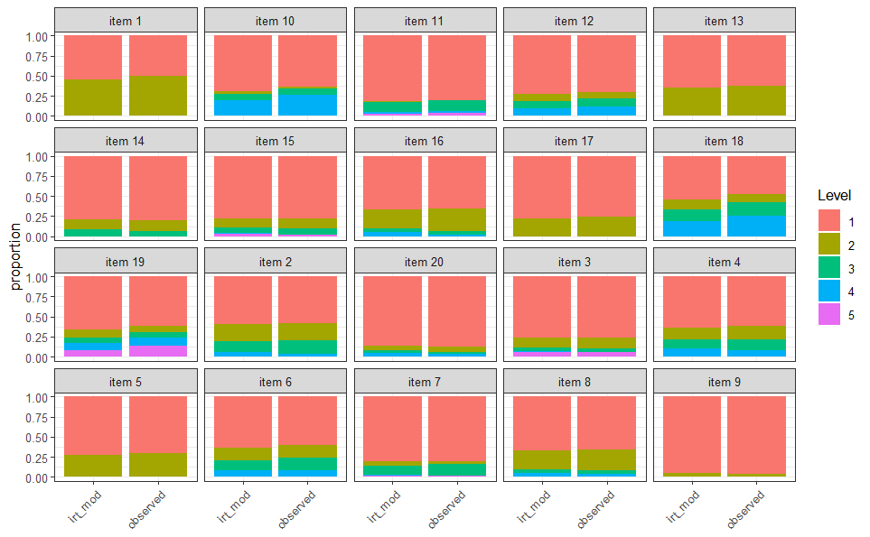
```

For all items, the observed and model-implied proportions agree well,
indicating that the estimated item parameters describe the data adequately.

## Norming new individuals

When norming new individuals, their responses must be coded in the same way
as the data used for fitting the model. For the GRM, all items must be coded
starting at 1. Apart from that, norming a new individual proceeds as for the
other models.

# Hierarchical models

Some tests have a hierarchical structure: the full test measures a general
latent trait, and each subtest measures a domain-specific trait. Each item
then carries information about its own domain and about the general trait.
In IRT-based continuous norming, such a structure is modeled with a
hierarchical IRT model [@heister2026HO]. The norming procedure is similar to the
unidimensional case, but the model fit must be checked for the full test as well as
for each domain.

To illustrate this, we use simulated data generated under the HO1PLnorm-C
model with three domains of 30 items each. HO1PLnorm-C assumes the items to follow a 1PL model, with constant correlations among domains across age (C).

```{r ho_loaddata, eval=FALSE, echo=TRUE, include=TRUE}
data("HOdata")
```

## Model selection

Hierarchical models are selected in the same two steps as described in the main
vignette, with two differences:

- `compare_IRTnorm_models()` can compare different hierarchical models (for
  example, models with constant, proportional, or free correlations across
  age), as long as all compared models are multidimensional.
- `compare_age_models()` is only available for unidimensional models. To find
  suitable polynomial degrees, select them separately for each domain, using
  the corresponding unidimensional model on the items of that domain.

Here, we assume that the best model is known.

## Fitting the model

When fitting a hierarchical model, you must indicate which domain each item
measures. This is done with the `itemD` argument, a numeric vector with one
entry per item, in the same order as the items in `item_variables`. The
domains are numbered consecutively, starting at 1. In this example items are 
ordered by domain with each domain being measured with 30 items. 

```{r ho_fit, echo=TRUE, include=TRUE, eval=FALSE}
infoHO <- estimate_norming_model(irt_model = "HO1PLnorm-C",
                                 raw_data = HOdata,
                                 age_variable = "age",
                                 item_variables = 1:90,
                                 itemD = rep(1:3, each = 30),
                                 age_model = "poly",
                                 poly_mean = 3,
                                 poly_sd = 2,
                                 seed = 1234,
                                 iter_warmup = 500,
                                 iter_sampling = 500,
                                 extract_stan_object = TRUE)
```
Here we presume that convergence has been checked. How to check for convergence is described in the main
vignette.

## Evaluating the model fit

Because of the hierarchical structure, the fit must be assessed for the full
test as well as for each domain. 

### Raw score distribution

For the whole sample, `raw_score_ppc()` automatically evaluates the total
score and the score of each domain. `visual_raw_score_ppc()` shows them
in one plot with one panel per trait.

```{r ho_raw_ppc, echo=TRUE, include=TRUE, eval=FALSE}
raw_ppc <- raw_score_ppc(fit_info = infoHO)
visual_raw_score_ppc(raw_ppc)
```

```{r ho_raw_ppc_show, echo=FALSE, fig.width=6, out.width="100%", fig.align="center"}
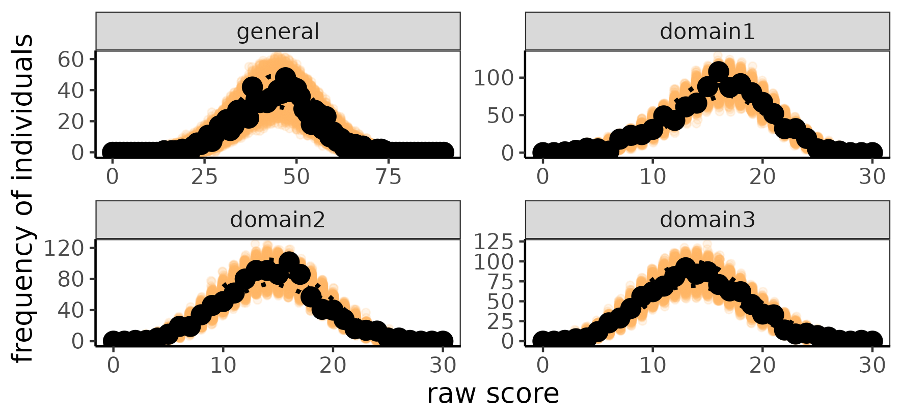
```

The observed raw score distributions of the total test and of the domains
agree well with the model-implied distributions.

To check the fit conditional upon age, we consider the fit in age groups. To this end, add the `age_range` argument. With age
groups, only one trait can be shown at a time, so `dim_plot` selects the
trait: `"general"` for the total score, or `"domain1"`, `"domain2"`, and so
on. In practice, all traits should be inspected. For illustration, we limit
ourselves to two.

```{r ho_raw_ppc_age, echo=TRUE, include=TRUE, eval=FALSE}
raw_ppc_age <- raw_score_ppc(fit_info = infoHO, age_range = seq(-2, 2, 1))
visual_raw_score_ppc(raw_ppc_age, dim_plot = "general")
visual_raw_score_ppc(raw_ppc_age, dim_plot = "domain1")
```

```{r ho_raw_ppc_age_show, echo=FALSE, fig.width=6, out.width="100%", fig.align="center"}
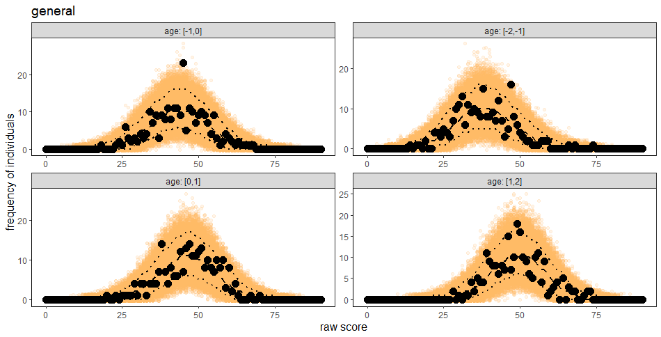
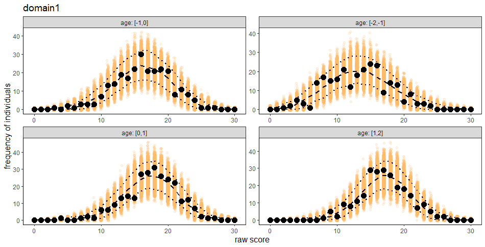
```

Both traits show a good fit across the age groups.


### Local independence
Local independence is expected to hold within and between domains. To check
this for the full test, call `item_residual_cor()` without further arguments.

```{r ho_resid_all, echo=TRUE, include=TRUE, eval=FALSE}
res_info <- item_residual_cor(fit_info = infoHO)
```

The function plots a heat map of the item residual correlations. Solid black
lines mark the domains. The rectangles on the diagonal show pairs of items
from the same domain, and the squares show pairs of items from
different domains. The domains are ordered from left to right, so domain 1 is
at the bottom left and domain 3 at the top right. The function also prints
the range of the residual correlations and their averages within and between
domains. If the general trait sufficiently explains the associations between
the domains, the averages within and between domains should be similar.

```{r ho_resid_all_results, echo=FALSE, include=TRUE, eval=TRUE}
test_env <- new.env()
data("HOex_res_info_all", package = "IRTnorm", envir = test_env)
test_env$HOex_res_info_all$summary_info
test_env$HOex_res_info_all$compare_domains
```

```{r ho_resid_all_show, echo=FALSE, fig.width=6, out.width="100%", fig.align="center"}
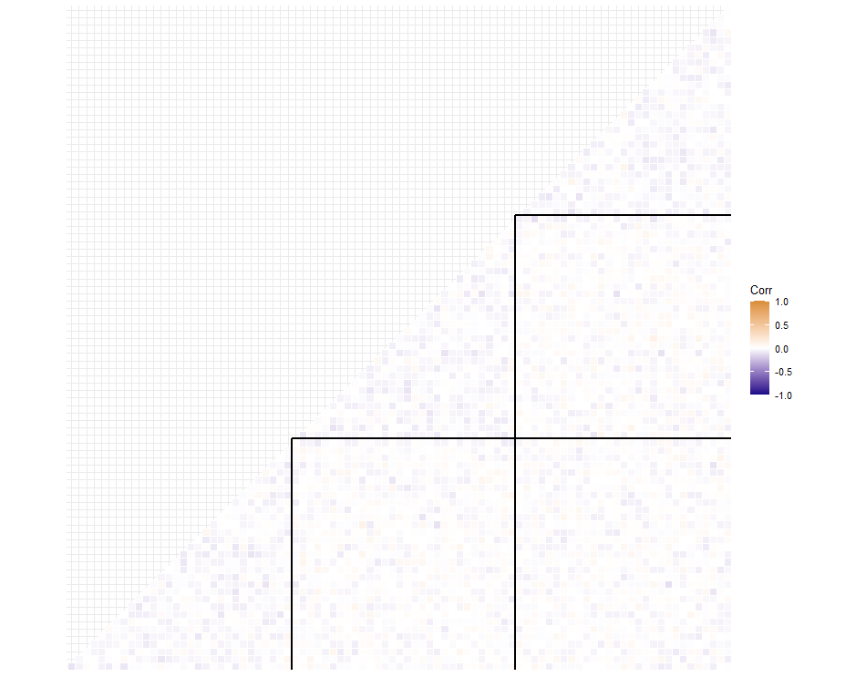
```

In this example, the residual correlations lie between -0.12 and 0.11, and
the averages within and between domains are similar, as desired.

To inspect a single domain in detail, use the `domain` argument. The function
then restricts the analysis to the items of this domain and plots its heat
map. This is especially useful if the check for the full test reveals
problems.

```{r ho_resid_domain1, echo=TRUE, include=TRUE, eval=FALSE}
item_residual_cor(fit_info = infoHO, domain = 1)
```

```{r ho_resid_domain1_results, echo=FALSE, include=TRUE, eval=TRUE}
test_env <- new.env()
data("HOex_res_info1", package = "IRTnorm", envir = test_env)
test_env$HOex_res_info1
```

```{r ho_resid_domain1_show, echo=FALSE, fig.width=6, out.width="100%", fig.align="center"}
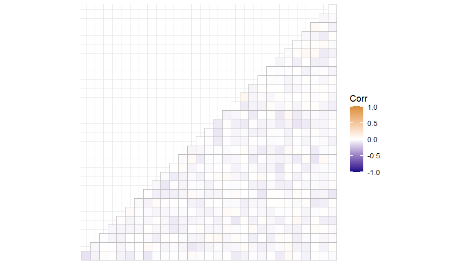
```

### Correlations between domains

The function `cor_structure()`, which is only available for hierarchical
models, shows the correlations between the domains. What it returns depends
on the model:

- For models with age-independent correlations, such as HO1PLnorm-C, it
  returns a table with the model-implied correlation of each pair of domains
  next to the correlation of the observed domain sum scores.
- For models with age-dependent correlations, it calculates the model-implied
  correlations for each person and, with `visual = TRUE`, plots them against
  age.

```{r ho_cor_structure, echo=TRUE, include=TRUE, eval=FALSE}
cor_info <- cor_structure(fit_info = infoHO)
```

```{r ho_cor_structure_results, echo=FALSE, include=TRUE, eval=TRUE}
test_env <- new.env()
data("HOex_cor_info", package = "IRTnorm", envir = test_env)
test_env$HOex_cor_info
```

The sum score correlations and the model-implied correlations should be close.
In addition, experts with content knowledge should judge whether the correlations align with theoretical expectations about the constructs.


### Item and person fit

The item fit and the person fit are shown per domain.

```{r ho_itemfit, echo=TRUE, include=TRUE, eval=FALSE}
item_person_fit(fit_info = infoHO, parameter = "item")
```

```{r ho_itemfit_show, echo=FALSE, fig.width=6, out.width="100%", fig.align="center"}
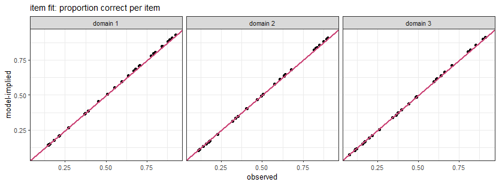
```

```{r ho_personfit, echo=TRUE, include=TRUE, eval=FALSE}
item_person_fit(fit_info = infoHO, parameter = "person")
```

```{r ho_personfit_show, echo=FALSE, fig.width=6, out.width="100%", fig.align="center"}
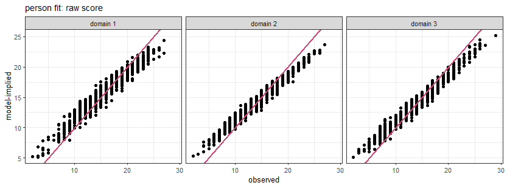
```

### Quantile curves

The model-implied quantile curves are shown in one
panel per domain.

```{r ho_qcurves, echo=TRUE, include=TRUE, eval=FALSE}
quantile_curves(fit_info = infoHO, probs = c(0.05, 0.25, 0.5, 0.75, 0.95))
```

```{r ho_qcurves_show, echo=FALSE, fig.width=6, out.width="100%", fig.align="center"}
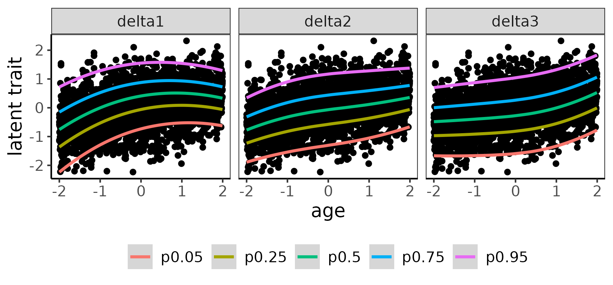
```

### Distribution of the norm scores

To check whether the norm scores follow a standard normal distribution within
age groups, select the trait to evaluate with `dim_plot`, as for
`visual_raw_score_ppc()`.

```{r ho_normscore_general, echo=TRUE, include=TRUE, eval=FALSE}
normscore_dist(fit_info = infoHO, age_range = seq(5, 21, 4),
               binwidth = 0.8, dim_plot = "general")
```

```{r ho_normscore_general_show, echo=FALSE, fig.width=6, out.width="100%", fig.align="center"}
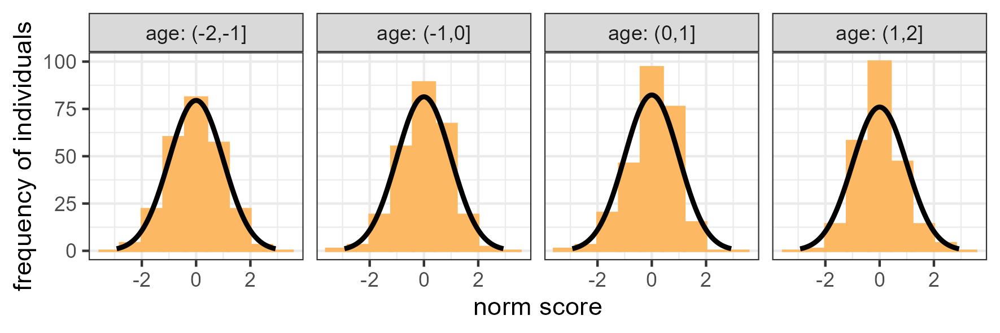
```

```{r ho_normscore_domain1, echo=TRUE, include=TRUE, eval=FALSE}
normscore_dist(fit_info = infoHO, age_range = seq(5, 21, 4),
               binwidth = 0.8, dim_plot = "domain1")
```

```{r ho_normscore_domain1_show, echo=FALSE, fig.width=6, out.width="100%", fig.align="center"}
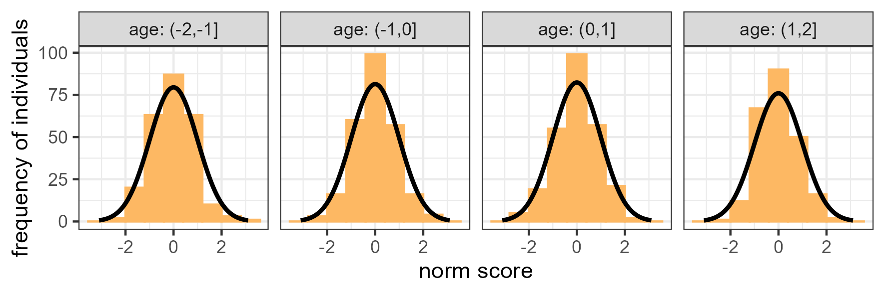
```


### Age effects
When visualizing the age-effect for hierachical model, the correlation between 
domains and the general latent trait is desplayed alongside the latent trait
mean and standard deviation. 

```{r ho_effect_age, echo=TRUE, include=TRUE, eval=FALSE}
effect_age(fit_info = infoHO)
```

```{r ho_effect_age_show, echo=FALSE, fig.width=6, out.width="100%", fig.align="center"}
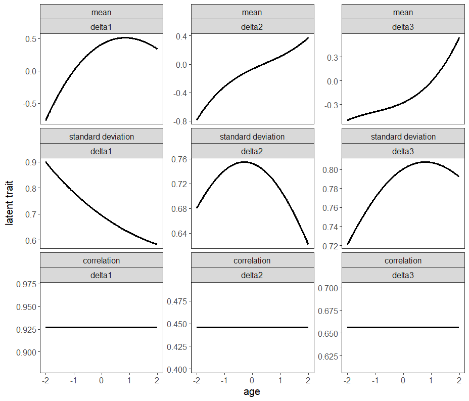
```

## Norming new individuals

Norming new individuals proceeds as in the unidimensional case with
`norm_new_individual()`. For hierarchical models, the result contains the
norm scores of the general trait and of each domain.

# Founding 
Development of `IRTnorm` was supported by Dutch Research Council NWO, [grant 406.27.GO.022](https://doi.org/10.61686/YHUOB23106).
